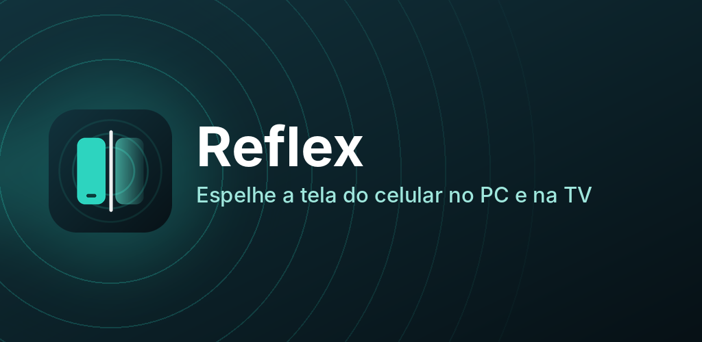

<h1 align="center">Reflex: espelhe a tela do celular no PC e na TV</h1>

Imagem e som do celular Android no computador e na TV, pelo Wi-Fi, sem cabos. Grátis.

## Baixar

| Aparelho | Download |
|---|---|
| 📱 **Celular Android** | [**Baixar Reflex-Android.apk**](https://github.com/cebratelli-bot/reflex-download/releases/latest/download/Reflex-Android.apk) |
| 💻 **PC com Windows 10 ou 11** | [**Baixar Reflex-Setup.exe**](https://github.com/cebratelli-bot/reflex-download/releases/latest/download/Reflex-Setup.exe) |
| 📺 **Fire TV Stick e Android TV** | [**Baixar Reflex-TV.apk**](https://github.com/cebratelli-bot/reflex-download/releases/latest/download/Reflex-TV.apk) · na TV, digite **is.gd/reflextv** no app *Downloader* |

Os links sempre baixam a versão mais nova. Depois de instalado, o Reflex se atualiza sozinho.

## Como instalar

**No celular**
1. Toque em *Baixar Reflex-Android.apk*.
2. Abra o arquivo baixado. Se o Android pedir, permita instalar apps desta fonte.
3. Abra o Reflex e escolha o idioma.

**No PC**
1. Baixe e abra o *Reflex-Setup.exe*. Não precisa de senha de administrador.
2. Se aparecer "O Windows protegeu o computador", clique em *Mais informações* e depois em *Executar assim mesmo*.
3. Na primeira vez, permita o Reflex em *Redes privadas* quando o Windows perguntar.

**Na TV (Fire TV Stick)**
1. Instale o app gratuito *Downloader* pela loja da Amazon.
2. Em *Configurações > Minha Fire TV > Opções do desenvolvedor*, permita instalar apps do *Downloader*. Se *Opções do desenvolvedor* não aparecer, entre em *Minha Fire TV > Sobre* e clique 7 vezes no nome do aparelho.
3. No Downloader, digite **is.gd/reflextv** e instale.

## Como usar

Deixe o celular e o PC (ou a TV) no **mesmo Wi-Fi**, abra o Reflex nos dois e toque no aparelho que aparece no radar do celular. Também dá para ler o QR code que aparece no PC ou na TV.

Para **ver o PC no celular**: no PC, clique em *Transmitir este PC*; no celular, toque em *Receber a tela*.

[Política de Privacidade](PRIVACIDADE.md)
